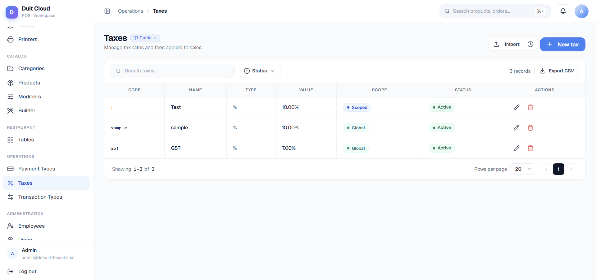

**Taxes** are calculated charges applied to items on a ticket — either as a fixed amount (e.g. 50¢ service fee) or a percentage of the sale (e.g. 10% GST). You can set a **global tax** that always applies, or a **scoped tax** that applies only to items in a specific category or product group. For advanced use, **tax rules** let you override the rate for a specific location or order mode (e.g. "6% GST in Region A, 10% in Region B"). **Associated taxes** let you stack taxes (e.g. a tax-on-service charge when service tax is applied).

Taxes also cover the adjustments that apply to the **whole bill** instead of to items: a delivery fee, a member discount, and **rounding** (for example to the nearest 0.05). They are set up on the same page, with the same rules, and each one is posted under its [transaction type](/features/transaction-types), so reports can group them.

<Frame>
  
</Frame>

## General Tab

The General tab defines the core tax — its code, rate type, and how it applies across your business.

### General Fields

| Field | Required | Description |
|-------|----------|-------------|
| **Code** | Yes | A short internal identifier, e.g. `SST` or `SVC`. Used in reports, exports, and tickets |
| **Name** | Yes | Display name shown on receipts and reports, e.g. `Sales & Service Tax` |
| **Type** | Yes | **Fixed Amount** (flat charge, e.g. 50¢), **Percentage** (rate, e.g. 10%) or **Rounding** (see [Rounding](#rounding)) |
| **Value** | Yes | For Fixed: the amount (e.g. `0.50`). For Percentage: the rate without % (e.g. `10` for 10%). For Rounding: the step (e.g. `0.05`). Supports up to 4 decimal places |
| **Calculated on** | Fixed and Percentage | **Items** (an ordinary tax, worked out per item), **Whole bill, before tax** or **Whole bill, after tax**. See [Whole-bill charges and discounts](#whole-bill-charges-and-discounts) |
| **Discount** | Whole-bill types | Takes the amount off the bill instead of adding it |
| **Max Amount** | No | For Percentage type only. If set (e.g. `100`), the calculated tax never exceeds this cap. Useful for percentage taxes with a service-charge ceiling |
| **Transaction Type** | Yes | Which transaction type ledger this tax posts to (e.g. Tax, Service Charge). Determines grouping on tickets and in reconciliation |
| **Tax Inclusive** | No | If enabled, the displayed price to customers **already includes** this tax. POS calculates the tax-exclusive base internally. Used for restaurants where menu prices show the "all-in" total |
| **Scope (Applies)** | Yes | **Everywhere** (global: the rules only change the value or switch it off) or **Only where a rule matches** (scoped). For items, a scoped tax also needs a Mapping. See the Rules and Mapping tabs |
| **Active** | No | Inactive taxes are excluded from all future transactions. Historical data is unchanged |

<Tip>
  **Tax Inclusive example**: A 10% GST tax-inclusive means the customer sees "100 THB" on the menu, but the system calculates 90.91 THB (ex-GST) + 9.09 THB (tax) = 100 THB total. Enable **Tax Inclusive** only if your menu prices are published with tax already baked in. Leave it off for most use cases (item prices are pre-tax, tax is added at checkout).
</Tip>

### Create a Tax

<Steps>
  <Step title="Go to Operations → Tax">
    Click **Tax** in the left sidebar under Operations.
  </Step>
  <Step title="Click New Tax">
    Enter the Code, Name, Type (Fixed or Percentage), Value, Transaction Type, and Scope.
  </Step>
  <Step title="Choose Scope">
    - **Global**: Tax applies to all items (or all items of the Transaction Type).
    - **Scoped**: Tax applies only to items you explicitly map in the Mapping tab below.
  </Step>
  <Step title="Save">
    Click **Create**. Tax is immediately active.
  </Step>
</Steps>

---

## Whole-bill charges and discounts

Set **Calculated on** to one of the whole-bill options and the tax stops working per item. It is worked out once on the bill, automatically, with no button for the cashier.

| Calculated on | What it does |
|---------------|--------------|
| **Whole bill, before tax** | Joins the amount that tax is worked out on, like the order discount does. |
| **Whole bill, after tax** | Added after tax and never taxed. |

Turn on **Discount** to take the amount off instead of adding it. A fixed discount never takes a bill below zero.

Every bill goes through the same steps, in this order:

<Steps>
  <Step title="Ticket amount">
    Item prices plus modifiers, minus any discount the cashier applied.
  </Step>
  <Step title="Before-tax types">
    Whole-bill charges and discounts set to **before tax**.
  </Step>
  <Step title="Tax">
    The per-item taxes, including service charge.
  </Step>
  <Step title="After-tax types">
    Whole-bill charges and discounts set to **after tax**.
  </Step>
  <Step title="Rounding">
    If a rounding tax applies, the final total is rounded. This is the amount the customer pays, whatever the payment method.
  </Step>
</Steps>

Every type in the same step works on the same amount. They do not stack on top of each other.

**Example.** A 25.20 ticket with a 10% member discount (before tax), a 5.00 delivery fee (after tax) and rounding to 0.05:

| Line | Amount |
|------|-------:|
| Subtotal | 25.20 |
| Member discount 10% | −2.52 |
| Tax | 3.63 |
| Delivery fee | 5.00 |
| **Total before rounding** | **31.31** |
| Rounding | −0.01 |
| **Total payable** | **31.30** |

Each line prints on the receipt, and rounding has its own line under the total.

---

## Rounding

Choose **Type: Rounding** to round every matching bill automatically.

| Field | Description |
|-------|-------------|
| **Round to (step)** | The step the final total is rounded to, for example `0.05`, `0.10` or `0.50`. |
| **Direction** | **Nearest** (the default) rounds up or down, whichever is closer. **Always up** never lowers the bill. **Always down** never raises it. |
| **Transaction Type** | The rounding is recorded under this transaction type, so reports show it as its own line. |

The step must be a whole multiple of the smallest unit of your currency, so it follows your number-of-decimals setting. With 2 decimals you can use `0.05`, `0.10` or `0.50`; `0.005` is only available if your currency uses 3 decimals. A whole-unit currency such as VND can use steps like `500`.

| Bill total | Step | Nearest | Always up | Always down |
|-----------:|-----:|--------:|----------:|------------:|
| 10.12 | 0.05 | 10.10 | 10.15 | 10.10 |
| 10.13 | 0.05 | 10.15 | 10.15 | 10.10 |
| 10.15 | 0.10 | 10.20 | 10.20 | 10.10 |

A refund is rounded the same way as the sale it reverses.

### Where rounding applies

Rounding with no rules applies to every location, order mode and channel. To treat one place differently, add another rounding tax and set **Applies** to **Only where a rule matches**, then add a rule for that place. A bill is rounded only once: when several rounding taxes match, the most specific one wins. A channel rule beats a location rule, which beats an order-mode rule.

For example, keep a general rounding to 0.05 for everyone, and add a second rounding to 0.10 with a rule for your mall outlet.

### Split bills

When a bill is split by items, each guest's bill gets its own charges, discounts and rounding. When a bill is split equally or by amount, the guests pay shares of one bill that already includes its adjustments, so each guest's ticket records its share.

### Reports

Shift reports and business date reports show an **Adjustments & rounding** section when any bill in the period was adjusted:

- Each whole-bill charge or discount, grouped by its transaction type, with the number of tickets and the total amount.
- **Rounding gain**: bills rounded up, with the count.
- **Rounding loss**: bills rounded down, with the count.
- **Rounding net**: the difference. It is already included in your sales total.

The POS shift summary and the printed shift report show the same section.

---

## Rules Tab

**Tax Rules** override the base tax value (or disable it entirely) for a specific **location**, **order mode** and/or **channel** (POS, Kiosk, Online, App and so on). This is how you implement regional rate differences or mode-specific charges. When a tax is set to **Only where a rule matches**, the rules are where it applies.

### Why Tax Rules Matter

Example: You operate in Singapore (10% GST) and Malaysia (6% SST). Create one "GST/SST" tax, then add two rules:
- Rule 1: Location = Singapore → Value 10%
- Rule 2: Location = Malaysia → Value 6%

Each location will charge the correct rate automatically.

### Tax Rule Priority

When several rules match a bill, the most specific one wins, and the same order applies to products, categories, modifiers and payment types: **channel, then location, then order mode**.

| Most specific | Least specific |
| --- | --- |
| Channel | (beats everything) |
| Location | |
| Order Mode | |
| Global | (fallback) |

**Example**: You have:
- Base 6% GST (Global)
- Rule A: Location = "Branch 1" → 5%
- Rule B: Order Mode = "Delivery" → 8%

A Delivery order at Branch 1 is taxed at **5% (Location wins)**. Add Rule C with Channel = "Kiosk" → 4%, and a Kiosk order is taxed at 4% wherever it is placed.

### Rules Fields

| Field | Required | Description |
|-------|----------|-------------|
| **Location** | No | Leave blank to apply to all locations. Select a specific location to apply only there |
| **Order Mode** | No | Leave blank to apply to all order modes. Select a specific mode to apply only there |
| **Channel** | No | Leave blank to apply to all channels. Select a channel (POS, Kiosk, Online, App, Other) to apply only there |
| **Override Value** | Yes | The new tax value (same format as General tab: amount for Fixed, percentage for Percentage) |
| **Enabled** | No | If unchecked, this rule is ignored and the base tax is used |

### Create a Tax Rule

<Steps>
  <Step title="Open the Tax you want to override">
    Click **Edit** on any tax, then go to the **Rules** tab.
  </Step>
  <Step title="Click Add Rule">
    Select a Location, Order Mode and/or Channel. At least one is required.
  </Step>
  <Step title="Enter the Override Value">
    Provide the new tax rate or amount for this context.
  </Step>
  <Step title="Save">
    The rule is active immediately. Future transactions in that context use the override.
  </Step>
</Steps>

---

## Mapping Tab

**Mapping** defines which **categories** and **products** a scoped tax applies to. Global taxes ignore this tab (they always apply); scoped taxes only apply to items in a matching mapping.

### Why Mapping Matters

Example: You want 10% tax on food items only, not beverages.
1. Create a tax "Food Tax" with Scope = **Scoped**.
2. In the Mapping tab, add two mappings:
   - Category = "Main Dishes"
   - Category = "Appetizers"
3. Beverages (even if in the menu) are never taxed because they aren't in the mapping.

### Mapping Rules

- A **Category mapping** applies to all products in that category (and sub-categories if nested).
- A **Product mapping** applies only to that specific product.
- If a product is explicitly mapped, its category mapping is ignored (product is more specific).
- **Scope must be "Scoped"** for mappings to have effect. Global scope bypasses this tab.
- Whole-bill taxes and rounding have no Mapping tab, because they apply to the bill and not to items.

### Add a Mapping

<Steps>
  <Step title="Open the Scoped Tax you want to map">
    Click **Edit**, then go to the **Mapping** tab.
  </Step>
  <Step title="Click Add Mapping">
    Choose **Category** or **Product**.
  </Step>
  <Step title="Select the Category or Product">
    The tax will now apply to that category (or product).
  </Step>
  <Step title="Repeat for other categories/products">
    Add as many mappings as needed.
  </Step>
  <Step title="Save">
    Mappings take effect immediately.
  </Step>
</Steps>

---

## Associated Taxes

**Associated taxes** let you stack taxes — apply one tax only when another tax is applied. This is used for compound charges like "apply a tax-on-service charge whenever the Service Tax is applied."

### Example: Service Tax + Tax on Service

1. Create "Service Tax" (e.g. 10%, Scope = Global).
2. Create "Tax on Service" (e.g. 5% of the Service Tax, Scope = Global).
3. In "Tax on Service" → **Associated Taxes** tab, select "Service Tax".
4. Result: When a ticket applies the Service Tax, it automatically also applies the Tax on Service to the service charge line, not to food items.

### Associated Taxes Fields

| Field | Description |
|-------|-------------|
| **Base Tax** | The tax(es) that trigger this one. When a base tax is applied, this tax is also applied (if conditions match) |

---

## Frequently Asked Questions

<AccordionGroup>
  <Accordion title="What's the difference between Scope (Global/Scoped) and Mapping?">
    **Scope** determines **when** the tax is used:
    - **Global**: Always apply to items of the matching transaction type.
    - **Scoped**: Only apply to items that are explicitly listed in the Mapping tab.
    
    **Mapping** defines **which items** (categories or products) qualify for a scoped tax. A global tax ignores mappings and always applies.
  </Accordion>
  <Accordion title="Can I have multiple taxes on one item?">
    Yes. If multiple taxes are global (or both match the item's mapping), all apply. They are stacked per line item and summed in the Tax Report. Use the Transaction Type field to group them clearly on the receipt.
  </Accordion>
  <Accordion title="Why is my override not working? I set a Location rule but it's not being used.">
    Check: (1) The Rule is set to **Enabled**. (2) The Rule's Location matches where the sale occurred. (3) If a Channel rule also exists for that order, the **Channel rule wins**, then Location, then Order Mode. See Tax Rule Priority above.
  </Accordion>
  <Accordion title="How do I disable a tax without deleting it?">
    Uncheck the **Active** field on the General tab. Inactive taxes are excluded from all new transactions but historical data is preserved. To temporarily override a tax for one context, create a Rule with Override Value = 0 and enable it for that location/mode.
  </Accordion>
  <Accordion title="What's the difference between Tax Inclusive and Tax Exclusive?">
    **Tax Exclusive** (default): Menu prices shown to customers don't include tax. Tax is calculated and added at checkout. "Item 100 → +10% tax → 110 charged".
    
    **Tax Inclusive**: Menu prices already include tax. The system calculates the tax-free base internally. "Menu shows 110 → system calculates 100 base + 10 tax → 110 charged". Use this only if your menu prices are published with tax baked in (common in some regions).
  </Accordion>
  <Accordion title="Can I apply a percentage tax with a maximum cap?">
    Yes. Set Type = **Percentage**, enter the rate in Value (e.g. `10`), and optionally enter a Max Amount (e.g. `100`). If the calculated tax would exceed the max, it's capped at the max. Useful for service charges that are percentage-based but have a hard ceiling.
  </Accordion>
  <Accordion title="Can the cashier turn a whole-bill charge, discount or rounding on or off?">
    No. They always apply to the bills they match. Use the Discount button for one-off discounts.
  </Accordion>
  <Accordion title="I changed a rounding or charge. When does it reach the POS?">
    On the next sync, or when the cashier uses **Resync Data**. A bill that was already completed keeps the amounts it was charged.
  </Accordion>
  <Accordion title="Does it apply to bills made while the POS was offline?">
    Yes. The POS uses the last synced taxes and records the exact amounts on the bill, so it uploads correctly when the connection returns.
  </Accordion>
  <Accordion title="Why was my rounding step rejected?">
    The step must be a whole multiple of the smallest unit of your currency. Check the number of decimals in your settings.
  </Accordion>
</AccordionGroup>

## Related

<CardGroup cols={2}>
  <Card title="Products" icon="box" href="/features/products">Link taxes to categories and products via Mapping</Card>
  <Card title="Transaction Types" icon="list" href="/features/transaction-types">Choose the ledger account for tax posting</Card>
  <Card title="Order Modes" icon="route" href="/features/order-modes">Set mode-specific tax overrides in Rules</Card>
  <Card title="Reports" icon="chart-bar" href="/reports/overview">View tax collected by type and location</Card>
</CardGroup>
